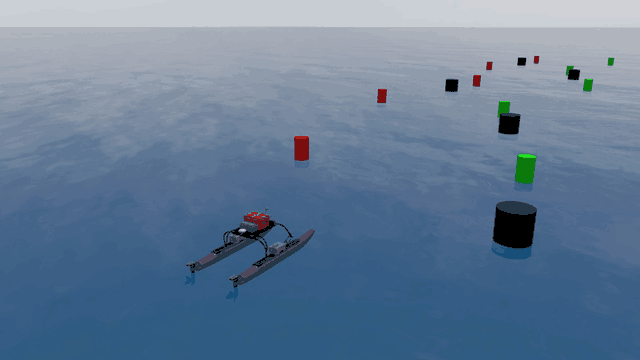
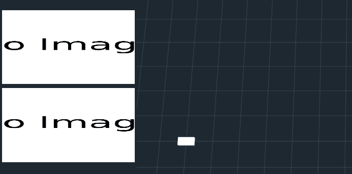

<div align="center">

# Njord VRX Simulator

**Test autonomous surface vessel software before it goes on the water**

[](https://github.com/MartinNordli/Surface_Vessel_Simulation/actions/workflows/ci.yml)



<br><sub>The built-in autonomy racing the slalom course on its own sensors (Gazebo, 20× speed, WAM-V reference boat)</sub>

</div>

<p align="center">
  
  <br><sub>Control & Autonomy's own DP nodes driving the four-thruster Munin placeholder to four target poses (RViz, about 11× speed). Grey: waiting, yellow: active, green: reached.</sub>
</p>

## What it does

A Gazebo simulation of a surface vessel on the water, wired to ROS 2 exactly
like a real boat: cameras, lidar, GPS and IMU come out as ROS topics, and the
boat moves only from per-thruster forces in newtons. Njord NTNU's teams can
connect their own nodes and test them before the boat is in the water.

- **Courses.** Buoy-gate races (`reference`, `slalom`) and "go to this
  position" courses for dynamic positioning (`goto_square`, `goto_retarget`,
  `station_keeping`, `hold_position`), in calm water, wind, waves or current.
- **Vessels.** The VRX WAM-V reference boat, and Njord-profile vessels with
  their own physics, including a four-thruster Munin placeholder. One YAML
  file per vessel.
- **Built-in autonomy** that can be swapped out piece by piece: buoy
  perception, occupancy mapping, D* Lite planning, guidance, and a setpoint
  controller.
- **Measured results.** An evaluator scores every run from ground truth and
  writes a report with the track, per-target results and thrust plots.
- **Reproducible.** Pinned dependencies, seeded runs, and a CI-tested Docker
  image for every commit.

> [!NOTE]
> The Njord-profile vessels are **uncalibrated** placeholders, not a measured
> model of Njord's boat. Results show how software behaves against this
> model; see [physics-model.md](docs/physics-model.md).

## Installation

You need an x86-64 PC with **Ubuntu 24.04** (or Windows with **WSL2** and
Ubuntu 24.04) and an **NVIDIA graphics card** with its driver installed
(`nvidia-smi` works). Docker does the rest; ROS and Gazebo are not installed
on the PC.

```bash
# 1. Get the code
git clone https://github.com/MartinNordli/Surface_Vessel_Simulation.git
cd Surface_Vessel_Simulation

# 2. Install Docker and the NVIDIA Container Toolkit (once per PC)
sudo bash scripts/setup-host.sh
sudo usermod -aG docker $USER      # then log out and in again (WSL2: wsl --shutdown)

# 3. Download the tested image for this commit (a few GB) and check the setup
./scripts/njord pull
./scripts/njord doctor

# 4. Run a race with the Gazebo and RViz windows
./scripts/njord gui slalom
```

`setup-host.sh` never installs a GPU driver; on WSL2 the Windows driver is
used. Without an NVIDIA card, put `NJORD_CPU=1` in front of the commands
(slow software rendering). After changing code that is not yet pushed, use
`./scripts/njord build` instead of `pull`.

## Quick start

```bash
./scripts/njord gui goto_square                                  # setpoint course with windows
VESSEL_CONFIG=/config/vessels/munin_v0.yaml ./scripts/njord gui station_keeping
SEED=2 ENVIRONMENT=moderate ./scripts/njord demo slalom          # without windows
CONTROLLER=external ./scripts/njord gui goto_square              # your own controller drives
./scripts/njord help                                             # all commands
```

Each run writes `outputs/run-<time>/report.html`. Every run option, course and
setting is in [docs/running.md](docs/running.md).

## Repository layout

```
njord_sim/              ROS 2 package
  njord_sim/            nodes (*_node.py), ROS-free logic (*_core.py), configuration
  launch/               simulator and autonomy launch files
  config/               vessels/, algorithms.yaml, RViz layout, examples
njord_gz_plugins/       C++ Gazebo plugins: Njord physics, actuator watchdog, contacts
scenarios/              one YAML file per course
scripts/                njord CLI, host setup, C&A node runner, run and report tools
tests/                  unit and integration tests
validation/             live checks and acceptance tools
sandbox/                headless planner demo without ROS or Gazebo
docker/                 image dependencies, lock file, entrypoint
docs/                   documentation
```

Every file is described in [docs/codebase.md](docs/codebase.md).

## Documentation

| Document | Contents |
|---|---|
| [Running the simulator](docs/running.md) | All courses, vessels and settings; GUI and headless runs; changing the configuration; results |
| [Control & Autonomy guide](docs/control-autonomy.md) | Step by step: set up a PC, build C&A's nodes, run setpoint courses with windows |
| [ROS 2 interface](docs/ros2-interface.md) | Topics, message types, frames, QoS, timing rules, connecting your own nodes |
| [Configuration](docs/configuration.md) | Every setting, the file formats and parameter precedence |
| [Codebase](docs/codebase.md) | What each directory and file does |
| [Physics model](docs/physics-model.md) | How the vessel physics is computed and how it will be calibrated |
| [Validation](docs/validation.md) | Tests, CI and measured evidence |
| [AGENTS.md](AGENTS.md), [agent workflows](docs/agent-workflows.md) | Engineering rules and verification steps for contributors |

Older decision documents (platform choice, open questions to C&A) are in
[docs/archive/](docs/archive/).

## Contributing

Work on a branch (`git checkout -b feat/<topic>`), keep changes small and run
the checks for what you touched ([agent-workflows.md](docs/agent-workflows.md)).
The quick loop without Docker:

```bash
python3 -m unittest discover -s tests -p 'test_*.py'
```

`./scripts/njord test` runs the complete suite in the container; CI runs it on
every push.

## Acknowledgements

Built on [VRX](https://github.com/osrf/vrx) and [Gazebo](https://gazebosim.org/).
The Docker setup derives from the Apache-2.0 licensed
[VRX v3.1.0 container setup](https://github.com/osrf/vrx/tree/v3.1.0/docker)
and retains its [license](docker/LICENSE.vrx). WAM-V assets and VRX plugins
keep their upstream licenses.
