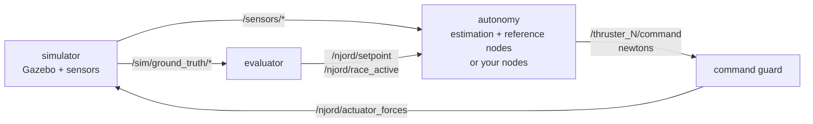

# ROS 2 interface

Every topic the simulator publishes and subscribes to, with message types,
frames, QoS and timing, and the rules a node must follow to drive the boat.
Names are defined once in `njord_sim/njord_sim/constants.py` and are the same
for every vessel.

## 1. Basics

| Setting | Value |
|---|---|
| ROS 2 distribution | Jazzy (in the simulator image). Nodes on Humble have also worked; see [section 9](#9-connecting-your-own-nodes). |
| `ROS_DOMAIN_ID` | `42` (change with the `ROS_DOMAIN_ID` environment variable) |
| DDS | Fast DDS with `FASTDDS_BUILTIN_TRANSPORTS=UDPv4`, host network |
| Clock | Simulation time on `/clock`. **Every node must run with `use_sim_time:=true`.** |
| Namespace | None: topics are global (`/thruster_1/command`, not `/munin/thruster_1/command`) |
| Units | SI: metres, seconds, radians, newtons |

The simulator runs as three Docker containers on the host network:
`simulator` (Gazebo, the vessel, sensors and the ROS–Gazebo bridges),
`autonomy` (state estimation, the command guard and the replaceable
reference algorithms) and `evaluator` (scoring). A node on the same machine
with the same domain sees all topics.



## 2. Frames and conventions

The simulator follows ROS conventions (REP 103 and REP 105):

- **`map`**: fixed world frame, ENU (x east, y north, z up). The origin is the
  GPS datum 63.4305 N, 10.3951 E (Trondheim). Poses, paths, goals and
  setpoints are in `map`.
- **`odom`**: continuous local frame between `map` and the boat. With
  `STATE_SOURCE=truth` it coincides with `map`.
- **`base_link`**: the boat body, FLU (x forward, y left/port, z up). The
  odometry twist and thruster positions in the vessel file are in this frame.
- **Sensor frames** below `base_link`: `imu_link`, `gps_link`, `lidar_link`,
  `front_left_camera_link`, `front_right_camera_link` and their
  `*_optical` frames (x right, y down, z forward).

TF tree: `map` → `odom` → `base_link` → sensor frames. Static sensor
transforms come from `robot_state_publisher` at the mounting poses in the
vessel file. Heading (yaw) is counter-clockwise from east.

**NED/FRD conversion.** If your mathematics uses NED (x north, y east, z
down) and an FRD body (x forward, y right, z down), convert at the boundary
of your node:

| Quantity | Simulator (ENU / FLU) | NED / FRD |
|---|---|---|
| Position | (x, y, z) | (y, x, −z) |
| Heading | ψ, counter-clockwise from east | π/2 − ψ, clockwise from north, wrapped to [−π, π) |
| Body velocity | (u, v, w) | (u, −v, −w) |
| Body angular rate | (p, q, r) | (p, −q, −r) |
| Body force or moment | (X, Y, N) | (X, −Y, −N) |

Thruster commands are scalars along each thruster's own direction, so they do
not change between conventions. `scripts/ned_dp_standin.py` is a runnable
example of this conversion.

## 3. Topics the simulator publishes

### Sensors

| Topic | Type | Frame | Default rate |
|---|---|---|---|
| `/sensors/cameras/front_left/image_raw`, `/sensors/cameras/front_right/image_raw` | `sensor_msgs/Image` | `front_{left,right}_camera_link_optical` | 15 Hz, 640 × 360, RGB, undistorted |
| `/sensors/cameras/front_left/camera_info`, `/sensors/cameras/front_right/camera_info` | `sensor_msgs/CameraInfo` | same | with each image |
| `/sensors/lidar/points` | `sensor_msgs/PointCloud2` | `lidar_link` | 10 Hz, 720 × 16 rays, 80 m |
| `/sensors/lidar/scan` | `sensor_msgs/LaserScan` | `lidar_link` | 10 Hz, planar scan including no-return (free-space) rays |
| `/sensors/gps/fix` | `sensor_msgs/NavSatFix` | `gps_link` | 10 Hz, metric Gaussian noise |
| `/sensors/imu/data` | `sensor_msgs/Imu` | `imu_link` | 100 Hz, noisy ENU attitude, angular rate and acceleration |
| `/clock` | `rosgraph_msgs/Clock` | — | simulation time |

Rates, resolutions and noise are set per vessel in its vessel file
([configuration.md](configuration.md#vessel-files)); the values above are the
WAM-V defaults. Sensor topics use best-effort sensor QoS. Message stamps are
the acquisition time and are never re-stamped.

### Navigation state

| Topic | Type | Content |
|---|---|---|
| `/njord/odometry` | `nav_msgs/Odometry` | Pose of `base_link` in `map`, twist in `base_link`. About 30 Hz. By default a GPS/IMU EKF estimate; with `STATE_SOURCE=truth` the simulator's ground truth, unchanged. |
| `/tf`, `/tf_static` | `tf2_msgs/TFMessage` | `map` → `odom` (global EKF or identity), `odom` → `base_link` (local EKF or truth), sensor mounts |
| `/njord/gps/odometry` | `nav_msgs/Odometry` | GPS fix converted to `map` (from `navsat_transform`), for your own estimator |

The EKFs fuse GPS position with IMU attitude and angular rate, but no
velocity. The estimated surge velocity is therefore noisy (0.4–0.7 m/s RMS
error measured, see [validation.md](validation.md)). Use `STATE_SOURCE=truth`
for controller work; the real boat gets its state from a Kongsberg Seapath,
which the simulator does not model.

### Targets (setpoint courses)

| Topic | Type | Content |
|---|---|---|
| `/njord/setpoint` | `geometry_msgs/PoseStamped` | Target position (`pose.position.x/y`) and heading (`pose.orientation`, rotation about z) in `map`. `header.stamp` is the simulation time the target was issued. Published reliable, transient local, depth 1. In a race the evaluator re-publishes the active target every second with the **same** stamp. |
| `/njord/setpoint_sequence` | `nav_msgs/Path` | Optional lookahead in a race: the active target first, then the remaining ones |

The latest target replaces the previous one and never expires. A message
with the same stamp and pose is the same target, not a new one. If the
course leaves the heading free, `orientation` points along the leg from the
previous target and the heading is not scored. Subscribe with `RELIABLE`
QoS; both `VOLATILE` and `TRANSIENT_LOCAL` durability work.

### Reference autonomy outputs (gate courses)

| Topic | Type | Content |
|---|---|---|
| `/njord/buoys` | `vision_msgs/Detection3DArray` | Fused red/green buoy tracks in `map` |
| `/njord/occupancy` | `nav_msgs/OccupancyGrid` | −1 unknown, 0 observed free, 100 inflated obstacle |
| `/njord/goal` | `geometry_msgs/PoseStamped` | Current mission waypoint in `map` |
| `/njord/path` | `nav_msgs/Path` | D* Lite route; an empty path explicitly invalidates the previous one |
| `/njord/plan_ms` | `std_msgs/Float64` | Planner search time, wall-clock milliseconds |

### Health and safety

| Topic | Type | Content |
|---|---|---|
| `/njord/guard_status` | `diagnostic_msgs/DiagnosticArray` | Command guard, 20 Hz: OK while thrust may pass, otherwise WARN with the reason, e.g. `thruster 3 command missing` |
| `/njord/navigation_status`, `/njord/planner_status`, `/njord/mission_status` | `diagnostic_msgs/DiagnosticArray` | Heartbeats of the reference nodes, 10 Hz simulation time |
| `/njord/controller_status` | `diagnostic_msgs/DiagnosticArray` | Heartbeat of the reference `setpoint_controller` |
| `/njord/race_active` | `std_msgs/Bool` | Evaluator heartbeat, transient local, 10 Hz steady time |
| `/njord/contacts` | `ros_gz_interfaces/Contacts` | Physics-verified contact heartbeat, 20 Hz |
| `/njord/actuator_forces` | `ros_gz_interfaces/Float32Array` | Forces the guard passes to Gazebo, one per thruster in vessel-file order (N) |

### Simulation only (`/sim/*`)

Everything under `/sim` is ground truth for evaluation and display. **Never
feed it to autonomy.**

| Topic | Type | Content |
|---|---|---|
| `/sim/ground_truth/odometry` | `nav_msgs/Odometry` | Exact vessel state |
| `/sim/sensors/gps/fix_raw`, `/sim/sensors/imu/data_raw` | `sensor_msgs/NavSatFix`, `sensor_msgs/Imu` | Gazebo GPS/IMU before the sensor adapter adds noise |
| `/sim/setpoint_status` | `diagnostic_msgs/DiagnosticArray` | Live score of the active target: distance, heading error, time held |
| `/sim/setpoint_markers` | `visualization_msgs/MarkerArray` | Target discs in RViz |
| `/sim/trajectory` | `nav_msgs/Path` | Travelled track |

The Njord physics plugin also publishes `/njord/actuator_wrench`
(`geometry_msgs/WrenchStamped`): the summed thruster force and moment about
the centre of mass. It is evaluation telemetry and must not feed autonomy.

## 4. Topics the simulator subscribes to

| Topic | Type | Content and rules |
|---|---|---|
| `/<thruster name>/command` | `std_msgs/Float64` | Force in **newtons** along the thruster's direction; negative is reverse. One topic per thruster in the vessel file: `/thruster_1/command`, `/thruster_2/command` (WAM-V, `njord_v1`) and `/thruster_3/command`, `/thruster_4/command` as well on `munin_v0`. Subscribed best effort, depth 1, so both reliable and best-effort publishers connect. Clipped to the thruster's limit and to `guidance.max_thrust` in `algorithms.yaml`. |
| `/njord/setpoint` | `geometry_msgs/PoseStamped` | In `lab` (free driving) the evaluator scores any target published here: from `./scripts/njord goto`, RViz's 2D Goal Pose tool or your own node. In a race the evaluator owns this topic. |

There is no `cmd_vel` input. A controller that outputs velocities needs its
own layer that turns them into thruster forces.

## 5. The command guard

The command guard is the only path from a controller to the thrusters. It
forwards a complete set of commands as soon as every thruster has a new one,
and sends **zero to all thrusters** while anything it requires is missing or
stale:

- a command on every thruster topic, received within the last 0.5 s of
  simulation time (and 2 s of wall time, which catches a stopped simulator);
- `/njord/navigation_status`;
- the planner and mission heartbeats while those reference nodes run, or
  `/njord/controller_status` while the reference setpoint controller runs;
- in a race (`demo`, `gui`, `benchmark`), the evaluator's
  `/njord/race_active`. `lab` does not need it.

The Gazebo plugin repeats the same freshness check, so a dead guard or bridge
also removes thrust. Zero thrust is not a brake: the boat keeps its momentum
and drifts with wind and current.

Your node must still stop by itself on missing or invalid input; the guard is
a safety net. When the boat does not move, read `/njord/guard_status`: it
names the input that blocks thrust.

## 6. Replacing the reference algorithms

Environment variables leave out reference nodes so your own can take their
place. They do not start your nodes.

| Setting | Reference nodes left out | What your node provides |
|---|---|---|
| `CONTROLLER=external` | `guidance` (gate course) or `setpoint_controller` (setpoint course) | `/<thruster>/command` in newtons |
| `PERCEPTION=external` | `perception` | `/njord/buoys` |
| `MAPPING=external` | `mapper` | `/njord/occupancy` |
| `AUTONOMY=external` | All of mapper, perception, mission, planner and guidance | Everything downstream of the sensors; no Njord status messages needed |

Estimation, the sensor adapter and the command guard always run. Keep exactly
one publisher per replaced output.

**Your own buoy detections** (`PERCEPTION=external`): reliable
`vision_msgs/Detection3DArray` on `/njord/buoys` in `map`, stamped with the
acquisition time of the image you processed. Each detection needs a stable
unique `id`, the position in `bbox.center.position` and a result with
`class_id` `red` or `green` and a score of at least 0.35. Publish an empty
array for a new image without buoys; the mission treats the array stamp as
image freshness (0.5 s maximum). 2D detections need depth and a transform to
`map` first.

**Your own map** (`MAPPING=external`): `nav_msgs/OccupancyGrid` on
`/njord/occupancy` in `map` with −1 unknown, 0 observed free and 100
occupied. Keep unknown cells unknown.

## 7. Run handoff

Before Gazebo starts, the simulator resolves the vessel, scenario and
algorithm files, writes generated models and `run_manifest.json` (SHA-256 of
every input) into the run directory, and publishes `run_ready.json` last.
Autonomy and the evaluator wait for that file and verify the manifest. A
team node is told only the course kind and the number of gates, never where
the gates or targets are; targets arrive one at a time on `/njord/setpoint`.

## 8. Looking at topics from the command line

While a run is going, from the simulator repository:

```bash
docker compose exec autonomy /entrypoint.sh ros2 topic list
docker compose exec autonomy /entrypoint.sh ros2 topic hz /njord/odometry
docker compose exec autonomy /entrypoint.sh ros2 topic info /thruster_1/command --verbose
docker compose exec autonomy /entrypoint.sh ros2 topic echo /njord/guard_status --field status
docker compose exec autonomy /entrypoint.sh ros2 run tf2_ros tf2_echo map base_link
```

On a host with ROS 2 Jazzy installed, `ROS_DOMAIN_ID=42` and
`FASTDDS_BUILTIN_TRANSPORTS=UDPv4` give the same view without Docker.

## 9. Connecting your own nodes

Any ROS 2 node on the same machine with `ROS_DOMAIN_ID=42`, no namespace and
`use_sim_time:=true` can talk to the simulator. There are three ways to run
it:

1. **In the simulator image (recommended).** `compose.team.yaml` adds a `team`
   service that mounts your workspace at `/team_ws` and joins the
   simulator's network and domain. Build and run inside it:

   ```bash
   export TEAM_WS_HOST=/absolute/path/to/your_ws NJORD_UID=$(id -u) NJORD_GID=$(id -g)
   docker compose -p njord-team -f compose.yaml -f compose.team.yaml run --rm team bash
   # inside the container:
   colcon build
   source install/setup.bash
   ros2 run <package> <node> --ros-args -p use_sim_time:=true
   ```

   Use a separate project name (`-p njord-team`) so the container is not part
   of the race and does not keep `./scripts/njord demo` waiting. The image has
   `g++`, Eigen and NumPy, but not SciPy or pip.
   [control-autonomy.md](control-autonomy.md) shows a complete example with
   `scripts/ca-nodes.sh`.

2. **Natively on the host** with ROS 2 Jazzy:

   ```bash
   source /opt/ros/jazzy/setup.bash
   source ~/your_ws/install/setup.bash
   export ROS_DOMAIN_ID=42 FASTDDS_BUILTIN_TRANSPORTS=UDPv4
   ros2 run <package> <node> --ros-args -p use_sim_time:=true
   ```

3. **ROS 2 Humble.** A Humble node in a `ros:humble-ros-base` container on the
   same host exchanged `Odometry`, `PoseStamped`, `Float64` and `Clock` with
   the simulator correctly. The Humble side prints a harmless repeated
   `sequence size exceeds remaining buffer`, and `ros2 node list` does not
   show nodes across the two versions. ROS 2 does not promise compatibility
   between distributions; nodes on a second machine have not been tested.

Nodes in their own launch file receive parameters as usual. The reference
nodes take extra ROS parameters from `ROS_PARAMS_FILE`
([configuration.md](configuration.md#parameter-precedence)).
