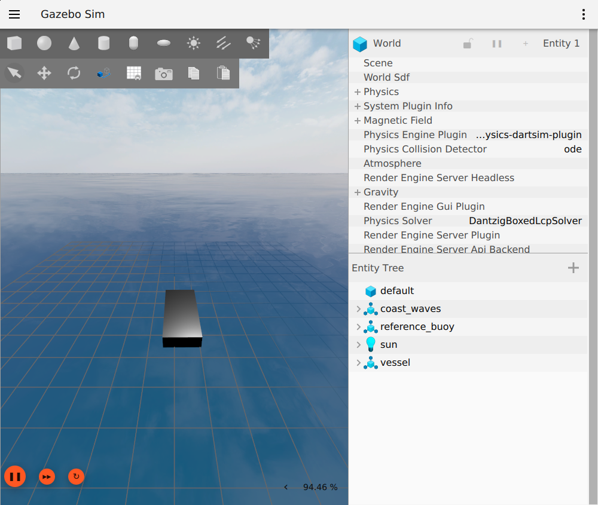
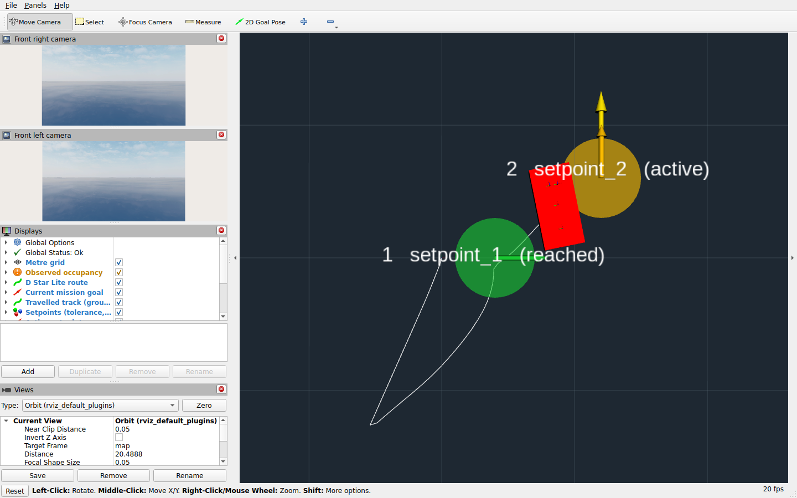

# Running the simulator

Everything the simulator can run, and how to change it and run again. All
commands go through `./scripts/njord` from the repository root; it picks the
right Docker Compose files (including WSL) and writes each run to a fresh
directory. Installation is in the [README](../README.md#installation).

Contents: [1 GUI runs](#1-gui-runs) · [2 The windows](#2-the-windows) ·
[3 Courses](#3-courses) · [4 Vessels](#4-vessels) ·
[5 Run settings](#5-run-settings) · [6 Free driving](#6-free-driving-lab) ·
[7 Change the configuration and run again](#7-change-the-configuration-and-run-again) ·
[8 Results](#8-results) · [9 Without GUI](#9-without-gui) ·
[10 Troubleshooting](#10-troubleshooting)

## 1. GUI runs

```bash
./scripts/njord gui                  # reference course with the WAM-V
./scripts/njord gui slalom           # any course name from scenarios/
SEED=2 ENVIRONMENT=moderate ./scripts/njord gui slalom
VESSEL_CONFIG=/config/vessels/munin_v0.yaml ./scripts/njord gui goto_square
```

`gui` starts a measured race with two windows, Gazebo and RViz. The race
starts by itself once the boat's sensors, navigation and controller are
ready, runs until the course is completed or fails, then closes Gazebo and
prints the path of the report:

```
Report: outputs/run-20261019T213859/report.html
```

The exit code is the result: 0 when the course was completed, non-zero
otherwise. `GUI=1 ./scripts/njord demo <course>` is the same as `gui`.

Run from a terminal on the desktop (not over SSH) so the windows can open.
On WSL2, `scripts/njord` adds the WSLg setup by itself.

## 2. The windows

### Gazebo: the simulation



Gazebo shows the water, the boat, the buoys and the obstacles. The real-time
factor is shown bottom right (about 90 % on the RTX 5090 used for testing).
The camera does not follow the boat: after long moves, follow the boat in
RViz or move the Gazebo camera with the mouse.

- **Do not close the Gazebo window during a run.** If you do, Gazebo asks
  `Do you really want to exit?`; choose `CANCEL`. `OK` stops the simulator
  and the race ends with `contact_monitor_timeout`.
- **Do not press pause or reset** (the orange buttons bottom left).
  Simulation time stops for every node; the evaluator is built to end the
  race with `odometry_timeout` after 30 s (not tried).
- `munin_v0` and `njord_v1` are drawn as grey boxes; they are placeholders,
  not hull models.

### RViz: what the boat knows and the targets



| In RViz | Meaning |
|---|---|
| WAM-V model, or a red box for `njord_v1` and `munin_v0` | The boat |
| White line | The track it has travelled (ground truth) |
| Coloured points | Lidar returns, coloured by height |
| Shaded cells | The observed occupancy map (gate courses) |
| Teal line | The planned D* Lite route (gate courses) |
| Orange arrow | The mission's current goal (gate courses) |
| Disc with an arrow and a label | A setpoint: radius = tolerance, arrow = heading. Yellow active, green reached, red failed, blue replaced, grey waiting |
| Yellow arrow | The active setpoint |
| Camera panels (left) | The two front cameras |

On setpoint courses the map, route and goal stay empty, and `Observed
occupancy` shows a warning icon: the reference mapper and planner only run
on gate courses.

RViz starts zoomed out over the whole course area. To get close to the boat:
choose **Focus Camera** (key C) and click on the boat, then scroll to zoom.
Left drag rotates, middle drag pans.

RViz runs in its own container. Closing it never ends a run, and it stays
open after the run so you can look at the result. The next `gui` command
replaces it; `docker rm -f njord-sim-rviz-1` closes it.

## 3. Courses

A course is a file in `scenarios/`; the file name is the course name. There
are three kinds.

### Gate races

The boat drives through red-left/green-right buoy gates using only its own
cameras and lidar. The reference autonomy (perception, mapping, mission,
D* Lite planning and guidance) drives unless you replace it.

| Course | Layout | Time limit |
|---|---|---|
| `reference` (default) | 3 gates 14 m wide, 2 extra obstacles | 360 s |
| `slalom` | 5 alternating gates, 5 obstacles flanking the route | 480 s |

Gate positions get a seeded random offset (`SEED`) of up to ±0.75 m
(`reference`) or ±0.5 m (`slalom`). Environments: `calm` and `moderate`.

### Setpoint courses ("go to this position")

The evaluator sends target poses on `/njord/setpoint` one at a time and
scores how the boat reaches and holds each one. The simulator's reference
`setpoint_controller` drives unless `CONTROLLER=external`
([control-autonomy.md](control-autonomy.md)).

| Course | Targets | Pass criterion |
|---|---|---|
| `goto_square` | 4 corners of a 20 m square: (20, 0) facing east, (20, 20) north, (0, 20) west, (0, 0) south | Each within 1.5 m and 15° for 5 s, 100 s per target |
| `goto_retarget` | (40, 0), replaced after 12 s; (15, 15), replaced after 15 s; then (25, 5) | Last target within 1.5 m and 15° for 5 s |
| `station_keeping` | One target 10 m east of the start, facing east | Within 1.0 m and 10° for 60 s, within 200 s |
| `hold_position` | The start pose (no step) | Within 1.0 m and 10° for 60 s, within 200 s |

Environments: `calm`, `windy` and `current`. Coordinates are metres in the
`map` frame (x east, y north); headings are counter-clockwise from east.

### Dynamics

`dynamics` is open water with one far gate, used by the dynamics
measurements in [validation.md](validation.md#5-dynamics-measurements). It is
not a race.

### Environments

| Name | Wind | Waves | Current | Courses |
|---|---|---|---|---|
| `calm` (default) | none | none | none | all |
| `moderate` | 3 m/s toward north-east, with gusts | yes | none | gate courses, `dynamics`; WAM-V only |
| `windy` | 4 m/s toward north-west, constant | none | none | setpoint courses |
| `current` | 4 m/s toward north-west | none | 0.3 m/s toward south | setpoint courses; Njord-profile vessels only |

The WAM-V uses VRX physics, which has waves but no current. The Njord
profile (`njord_v1`, `munin_v0`) has current but only flat water and
constant wind, so `moderate` is rejected for it.

## 4. Vessels

Select a vessel with `VESSEL_CONFIG` (a path inside the container; the
`njord_sim/config/` folder is mounted at `/config`):

| Vessel | `VESSEL_CONFIG=` | Thrusters | What it is |
|---|---|---|---|
| WAM-V (default) | `/config/vessels/wamv.yaml` | 2, parallel, aft | The VRX reference boat. Hull and hydrodynamics from VRX. |
| Njord test hull | `/config/vessels/njord_v1.yaml` | 2, parallel, aft | Uncalibrated analytic box hull with invented parameters |
| Munin placeholder | `/config/vessels/munin_v0.yaml` | 4, X layout at ±45° | The `njord_v1` hull with an assumed four-thruster layout. Can push sideways (dynamic positioning). |

None of these is a calibrated model of Njord's boat; see
[physics-model.md](physics-model.md).

## 5. Run settings

Put settings in front of the command; they apply to that run only.

```bash
SEED=3 ENVIRONMENT=moderate PROFILE=conservative ./scripts/njord gui slalom
```

| Setting | Default | Meaning |
|---|---|---|
| `SEED` | the course's seed | Gate offsets, wind gusts and sensor noise. Same seed, same inputs. |
| `ENVIRONMENT` | `calm` | Environment preset from the course file ([section 3](#environments)) |
| `PROFILE` | `fast` | Speed ceiling of the reference autonomy: `fast` (2.0 m/s) or `conservative` (1.0 m/s) |
| `VESSEL_CONFIG` | `/config/vessels/wamv.yaml` | Vessel file ([section 4](#4-vessels)) |
| `ALGORITHMS_CONFIG` | `/config/algorithms.yaml` | Tuning of the reference autonomy |
| `STATE_SOURCE` | `estimate` | `truth` navigates on the exact simulated state instead of the GPS/IMU estimate |
| `CONTROLLER`, `PERCEPTION`, `MAPPING`, `AUTONOMY` | `reference` | `external` leaves out that part of the reference autonomy, so your own node can take its place ([ros2-interface.md](ros2-interface.md#6-replacing-the-reference-algorithms)) |
| `REAL_TIME_FACTOR` | `1.0` | Target of simulated seconds per wall second |
| `ROS_PARAMS_FILE` | empty | Extra ROS parameters for reference nodes |
| `GUI` | `0` | `1` adds the windows to `demo` or `lab` |

The full list is in [configuration.md](configuration.md#environment-variables).

## 6. Free driving (`lab`)

`lab` starts the simulator without a race. Nothing ends the run until you
press Ctrl-C. Send targets and watch the boat drive to them:

```bash
# Terminal 1
VESSEL_CONFIG=/config/vessels/munin_v0.yaml GUI=1 ./scripts/njord lab goto_square
# Terminal 2, from the repository root
./scripts/njord goto 15 5 90      # x = 15 m, y = 5 m, face north (90° from east)
./scripts/njord goto 0 0          # no heading: face along the line to the target
```

In RViz, the **2D Goal Pose** tool (key G) does the same: click where the
boat should go and drag in the direction it should face.

Each target is scored (1.5 m, 15°, held 5 s) until the next one arrives.
Ctrl-C in terminal 1 writes the report with one section per target. On a
setpoint course the reference controller drives to the targets; on a gate
course the reference autonomy drives the gates and targets are only scored.
With `CONTROLLER=external` or `AUTONOMY=external` your own node drives, and
with no node the boat drifts.

## 7. Change the configuration and run again

Each setting lives in exactly one file. Edit it and start a new run.

| To change | Edit | Rebuild? |
|---|---|---|
| Sensors (resolution, rate, range, noise) of the WAM-V; its thrust limit | `njord_sim/config/vessels/wamv.yaml` | no |
| Anything about a Njord-profile boat: mass, geometry, damping, thrusters, sensors | `njord_sim/config/vessels/njord_v1.yaml` or `munin_v0.yaml` | no |
| Speed profiles, guidance and setpoint-controller gains, planner and map | `njord_sim/config/algorithms.yaml` | no |
| Gates, obstacles, setpoints, start pose, time limit, wind, waves, current | `scenarios/<course>.yaml` | **yes**: `./scripts/njord build` |
| WAM-V sensor mounting poses | `njord_sim/config/vessels/wamv_sensors.xacro` | **yes** |
| GPS datum, command timeout, topic names | `njord_sim/njord_sim/constants.py` | **yes** |

Files under `njord_sim/config/` are mounted into the containers, so the next
run reads them. Scenarios and code are copied into the image, so changing
them needs `./scripts/njord build` (fast when only those files changed;
Docker reuses the Gazebo and VRX layers). Every file
is validated before Gazebo starts: an unknown key or invalid value stops the
run with a message naming it.

**Example: give Munin more thrust.** In `munin_v0.yaml`, change
`forward_limit_n` and `reverse_limit_n` of each thruster, then:

```bash
VESSEL_CONFIG=/config/vessels/munin_v0.yaml ./scripts/njord gui station_keeping
```

**Example: a new setpoint course.** Copy `scenarios/goto_square.yaml` to
`scenarios/my_course.yaml`, edit the targets, then:

```bash
./scripts/njord build
./scripts/njord gui my_course
```

```yaml
setpoints:
  defaults: {tolerance_m: 1.5, heading_tolerance_deg: 15.0, hold_s: 5.0, timeout_s: 100.0}
  sequence:
  - {name: p1, position: [25.0, 0.0], heading_deg_enu: 0.0}
  - {name: p2, position: [25.0, 20.0], heading_deg_enu: 90.0, hold_s: 10.0}
  - {name: p3, position: [0.0, 20.0]}                           # heading free
  - {name: swap, position: [10.0, 5.0], advance_after_s: 8.0}   # replaced after 8 s, reached or not
  - {name: home, position: [0.0, 0.0], heading_deg_enu: -90.0}
```

A course has either `gates` or `setpoints`, and at least one entry under
`obstacles` (the contact monitor needs one). The full format is in
[configuration.md](configuration.md#scenario-files).

**Example: a new vessel.** Copy `munin_v0.yaml` to
`njord_sim/config/vessels/my_boat.yaml`, change it, and select it with
`VESSEL_CONFIG=/config/vessels/my_boat.yaml`. No rebuild is needed.

**Example: change only a few WAM-V sensor settings.** A flat file with just
the keys to change is merged onto `wamv.yaml`:

```bash
VESSEL_CONFIG=/config/examples/sensors_low_bandwidth.yaml ./scripts/njord gui slalom
```

**Your own configuration folder.** To keep your files out of the
repository, mount another folder at `/config`:

```bash
mkdir -p ~/my-config/vessels
cp njord_sim/config/vessels/munin_v0.yaml ~/my-config/vessels/
cp njord_sim/config/algorithms.yaml ~/my-config/
CONFIG_HOST=$HOME/my-config VESSEL_CONFIG=/config/vessels/munin_v0.yaml \
  ALGORITHMS_CONFIG=/config/algorithms.yaml ./scripts/njord gui goto_square
```

## 8. Results

Every run writes a new directory `outputs/run-<time>/`:

| File | Content |
|---|---|
| `report.html` | Opens offline in a browser: result, top view of the track and course, a table per gate or target, and plots of distance, heading error, speed and thrust per thruster |
| `run_metrics.json` | All numbers, plus provenance: commit, image, seed and checksums of every input |
| `timeseries.csv` | 10 Hz ground-truth pose, body velocity, active target error and thrust per thruster |
| `resolved_configuration.json`, `source_config/` | The exact configuration the run used |

`./scripts/njord report [run-dir]` rebuilds `report.html`.

**Run status** (`status` in `run_metrics.json`):

| Status | Meaning |
|---|---|
| `completed` | Every gate or required target done |
| `setpoints_failed` | The target sequence finished but a required target was not reached |
| `collision`, `geometric_overlap` | The boat hit something, or its hull envelope overlapped an obstacle |
| `simulation_timeout` | The course time limit ran out |
| `wall_timeout`, `odometry_timeout`, `contact_monitor_timeout` | Infrastructure failed (e.g. Gazebo closed or paused) |
| `stopped` | A `lab` run was ended with Ctrl-C |

**Per target** (`setpoints[]`): `outcome`, `time_to_reach_s`,
`time_to_settle_s`, `final_distance_m`, `final_heading_error_deg`, hold
precision (`hold_rms_distance_m`, `hold_max_distance_m`,
`hold_rms_heading_error_deg`), `overshoot_m`, `max_cross_track_m`,
`path_length_m`, `path_efficiency` and `force_impulse_ns` (∫ Σ|F| dt, a
measure of control effort, not electrical energy).

All scoring uses the simulator's ground truth. `state_source` in the
metrics says whether the boat navigated on the estimate or on truth.

## 9. Without GUI

Everything above works without windows; use `demo` instead of `gui` and leave
out `GUI=1`.

```bash
./scripts/njord demo slalom                       # measured race, no windows
SEED=1 VESSEL_CONFIG=/config/vessels/munin_v0.yaml ./scripts/njord demo goto_square
./scripts/njord lab goto_square                   # free driving without windows
```

### Benchmark: many races at once

```bash
./scripts/njord benchmark slalom --seeds 1 2 3 --environments calm moderate
./scripts/njord benchmark slalom --dry-run        # print the matrix only
```

Runs every combination of seed, environment and speed profile in isolated
Docker projects (`--jobs 2` runs two at a time) and writes `summary.json`
and one directory per race under `outputs/benchmark-<time>/`. Keep failures
when comparing.

### Film: an animated GIF

```bash
./scripts/njord film slalom --output docs/media/slalom.gif
```

Runs a headless race with an extra chase camera (presentation only, not seen
by autonomy) and turns the frames into a GIF at 20× speed. It needs Python 3
with NumPy and Pillow on the host. `--speed`, `--fps` and `--width` change
the GIF.

### Record and replay

```bash
# Native Linux; on WSL use COMPOSE_FILE=compose.yaml:compose.wsl.yaml:compose.record.yaml
COMPOSE_FILE=compose.yaml:compose.record.yaml ./scripts/njord demo slalom recorder
```

Writes a compressed MCAP bag of sensors, TF, navigation, commands and
evaluation topics into the run directory. Replay the sensors, with the
simulator stopped and in a separate ROS domain:

```bash
export OUTPUT_HOST="$PWD/outputs/run-<time>"
ROS_DOMAIN_ID=43 docker compose run --rm autonomy ros2 bag play /outputs/bag --clock \
  --topics /tf /tf_static /njord/odometry /sensors/lidar/points \
  /sensors/cameras/front_left/image_raw /sensors/cameras/front_left/camera_info
```

Start your node on domain 43 with `use_sim_time:=true`. Replay cannot react
to new commands; comparing controllers needs new simulated runs.

### Checks

```bash
./scripts/njord doctor      # Docker, Compose, GPU and image
./scripts/njord selftest    # start the simulator, check cameras, lidar and navigation, stop
./scripts/njord test        # full test suite in the container
```

### Simulator only, or a long session

```bash
./scripts/njord simulator slalom      # Gazebo and sensors, no autonomy and no evaluator
```

For a session you inspect from other terminals, start `lab` and use
`docker compose exec autonomy /entrypoint.sh ros2 …` from the repository
root ([ros2-interface.md](ros2-interface.md#8-looking-at-topics-from-the-command-line)).

### No GPU

`NJORD_CPU=1` in front of any command uses software rendering. Sensors work,
but slowly (real-time factor around 0.7), and it says nothing about GPU
rendering performance. CI uses it.

## 10. Troubleshooting

| Symptom | Fix |
|---|---|
| `Image … has a missing or mismatched … digest` | The code changed after the image was made. Run `./scripts/njord pull` (pushed commits) or `./scripts/njord build`. |
| No windows open | Run from a terminal on the desktop, as the logged-in user; `echo $DISPLAY` must print something. |
| The boat does not move | `docker compose exec autonomy /entrypoint.sh ros2 topic echo /njord/guard_status --field status` names what blocks thrust. |
| A setpoint race never starts | The terminal prints what it waits for, e.g. `Waiting for a publisher on /thruster_1/command`: with `CONTROLLER=external` your controller is not connected. |
| `moderate` rejected for a Njord-profile vessel | That profile supports flat water only; use `calm`, `windy` or `current`. |
| A run hangs after the race | Another container from the same Compose project is still running; stop it, or give team containers their own project name (`-p`). |
