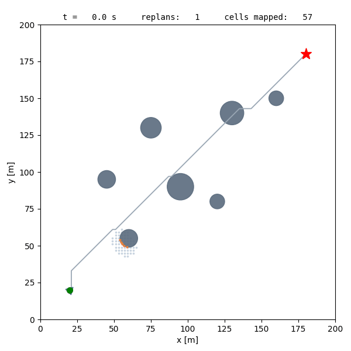

# Validation

How the simulator is tested, what CI checks, and the measured evidence behind
the claims in the documentation. Evidence is reported as measured, with its
scope: a passing CPU test does not establish GPU rendering, marine fidelity,
ROS integration or collision-free completion.

## 1. Running the tests

```bash
python3 tests/test_dstar_lite.py                       # D* Lite against an independent A*
python3 -m unittest discover -s tests -p 'test_*.py'   # host suite, no Docker
./scripts/njord test                                   # full suite in the container
./scripts/njord selftest                               # live cameras, lidar and navigation on the GPU
```

The host suite skips tests whose ROS or Gazebo dependencies are missing; only
`./scripts/njord test` is a complete pass. Which checks a change needs, per
area, is in [agent-workflows.md](agent-workflows.md#verification-by-change-area).

## 2. What the tests cover

- **Planning:** D* Lite against an independent A* reference, incremental
  obstacle repair, invalid endpoints and grid geometry.
- **Mapping and perception:** ray tracing equal to a reference Bresenham loop
  for random, off-map and full 720-ray scans; unknown/free/occupied cells and
  aging; scan ordering; self filtering; full 3D sensor transforms; camera
  colour detection and lidar association; TF wait queues.
- **Mission and scoring:** ordered gates, search and retry checked with the
  scorer's own crossing rule, collision scoring, strict metrics, slalom
  feasibility on seeds 1–10, benchmark comparisons.
- **Setpoint courses:** schema, issuing order, hold, timeouts,
  `advance_after_s`, heading wrap, overshoot, path and impulse metrics
  (`test_setpoint_core.py`); the reference controller's allocation signs,
  braking, limits, freshness and a closed loop on a planar model
  (`test_setpoint_control.py`); the NED stand-in's conversion and allocation
  (`test_ned_standin.py`); the report (`test_report_core.py`).
- **Configuration:** schema validation, partial WAM-V overrides, speed
  profiles for every vessel, parameter precedence, snapshots, and all eight
  controller/perception/mapping combinations plus full external mode.
- **Physics:** the plugin's header-only C++ (`hydrostatics_test.cc`,
  `loads_test.cc`) against hand-derived cases and against vectors written by
  the independent Python mirror `physics_core.py`, so a change on either side
  fails; generated SDF signs and plugins; analytic oracles for flotation and
  momentum balance. These show the code matches its formulas, not that the
  formulas match the boat.
- **Safety:** command guard decisions on simulation and steady time; truth
  relay drops invalid input; run handoff never reveals gate geometry.
- **ROS transport:** real DDS tests in isolated domains for the evaluator,
  sensors and team launch selection.

The headless sandbox (`python3 sandbox/headless_demo.py`) runs the planner
and guidance closed loop against a 3-DOF boat and a 2D lidar, without ROS or
Gazebo; five seeds take about ten seconds and fail if any seed collides or
misses the goal.



## 3. Continuous integration

`.github/workflows/ci.yml` runs on every push, `v*` tag and fork pull request:

1. `unit` runs the host suite.
2. `image` builds the image with a GHCR layer cache, checks that its source
   digest matches the commit, runs `./scripts/njord test` and a CPU-rendered
   `NJORD_CPU=1 ./scripts/njord selftest`, then publishes
   `ghcr.io/martinnordli/surface_vessel_simulation` as `sha-<commit>`,
   `latest` (main) and the tag name. Fork pull requests are tested, not
   published.

`./scripts/njord pull` fetches `sha-<commit>`, so every image other teams use
has passed CI. CI does not test GPU rendering, race completion or benchmarks.

## 4. Measured evidence

All runs below used GPU rendering on an RTX 5090 (WSL2) unless stated. Raw
results stay in the git-ignored `outputs/` of the machine that produced them;
each cited summary in [`evidence/`](evidence/) was written by
`scripts/summarize_evidence.py` and records the SHA-256 of every raw file.
`munin_v0` and `njord_v1` are uncalibrated placeholders, so these numbers
describe the simulator, the interface and the controllers, not Munin.

### Control & Autonomy's own nodes (2026-10-19)

C&A's `navigation_node`, `dp_node` and `thrust_allocator` from `Njord2627`
`master` c1c4589, started with `scripts/ca-nodes.sh`, `munin_v0`,
`STATE_SOURCE=truth`, `CONTROLLER=external`, seed 1, real-time factor
0.90–0.91. Steps and commands: [control-autonomy.md](control-autonomy.md).

| Run | Result |
|---|---|
| `goto_square`, calm, without and twice with windows (`gui`) | Completed all three times, 4/4: reached after 19.0–19.1, 44.7, 46.5 and 44.4–44.5 s; final error 0.15 m then 0.02 m; heading error 0.0° at the east-facing target and 7.8° at the other three |
| `station_keeping`, calm | Completed: reached after 10.0 s, held 60 s; hold 0.14 m RMS, 1.0 m max; overshoot 0.28 m; impulse 1119 N·s |
| `hold_position`, `current` | **setpoints_failed**: settled about 1.5 m from the target (1.0 m tolerance) until the 200 s timeout |
| `lab hold_position`, three `njord goto` targets | All reached; Ctrl-C wrote the report |

Evidence: [`gpu-ca-master-runs`](evidence/gpu-ca-master-runs.json).

### Control & Autonomy demo rehearsal (2026-10-12)

`scripts/ned_dp_standin.py` (then in `validation/`) did the conversion C&A
does, a PD station-keeping law and allocation in NED/FRD, standing in for
their nodes. `munin_v0`, `ENVIRONMENT=current` (4 m/s wind, 0.3 m/s current),
seed 1, real-time factor 0.92, at a029f8f and d5d219d; container suite 310
tests OK.

| Run | Result | Hold: RMS / max, RMS heading | Impulse |
|---|---|---|---|
| `hold_position`, reference controller, estimate | completed | 0.36 m / 0.72 m, 0.7° | 6696 N·s |
| `hold_position`, stand-in, truth | completed | 0.30 m / 0.33 m, 0.0° | 2525 N·s |
| `hold_position`, stand-in, estimate | completed | 0.36 m / 0.72 m, 0.7° | 6721 N·s |
| `station_keeping`, stand-in, truth | completed, reached after 5.9 s | 0.33 m / 1.00 m, 0.2° | 4218 N·s |
| `lab`, stand-in started after the simulator, eight `goto` targets | all reached in 6.3–8.6 s, 0.10–0.38 m | — | — |

Evidence: [`gpu-ca-demo-rehearsal`](evidence/gpu-ca-demo-rehearsal.json).

- **The estimated velocity is not usable for dynamic positioning.** The EKFs
  fuse GPS position and IMU attitude and rate, no velocity. Logged against
  ground truth on `station_keeping`, the surge velocity error was 0.38–0.72
  m/s RMS, as large as the velocity itself; position was within 0.28 m RMS.
  With the estimate the stand-in used 2.7 times the thrust impulse. Use
  `STATE_SOURCE=truth` for controller work.
- **`njord goto` repeats its target.** External subscribers matched up to
  3 s late and missed targets from the old sender (4–8 of 10 received). Since
  d5d219d it repeats the target for subscribers matched within 5 s; 10 of 10
  received.
- **ROS 2 Humble works against the Jazzy simulator on one host.** A Humble NED
  controller in a `ros:humble-ros-base` container completed `hold_position`
  and `station_keeping` and reached all eight `goto` targets. Humble printed a
  harmless `sequence size exceeds remaining buffer` about once a second, and
  `ros2 node list` did not show nodes across versions. Only `Odometry`,
  `PoseStamped`, `Float64` and `Clock` crossed. Evidence:
  [`gpu-ca-humble-controller`](evidence/gpu-ca-humble-controller.json).

### Setpoint courses with the reference controller (2026-10-06)

Seed 1, calm unless stated, at 23f502c and 99c8e28; container suite 300
tests OK.

| Run | Result | Per target: final error, hold RMS |
|---|---|---|
| WAM-V `goto_square` | completed 4/4 in 126 s | 0.10–0.34 m; 0.23–0.85 m, up to 8.6° |
| `munin_v0` `goto_square` | completed 4/4 in 81 s | 0.26–0.44 m; 0.86–0.92 m, ≤ 0.6° |
| `munin_v0` `goto_retarget` | completed in 45 s; two targets replaced as scripted, final 0.09 m | — |
| `munin_v0` `station_keeping`, `current` | completed; reached after 10.1 s, held 60 s | 0.34 m; 0.41 m / 0.9° |
| WAM-V `station_keeping`, `windy` | **setpoints_failed**: 0.84 m but heading 14.9° off (10° required) | — |
| `munin_v0` `goto_square`, external controller started 20 s late | completed 4/4 in 85 s; the race waited | 0.26–0.39 m |
| `munin_v0` `lab`, two `goto` targets, then `docker compose stop` | both reached, status `stopped` with report | — |

The two-thruster WAM-V cannot push sideways, so it cannot hold heading and
position in a side wind; `munin_v0`'s X layout can. Evidence:
[`gpu-setpoint-courses`](evidence/gpu-setpoint-courses.json).

### Gate races and platform checks (2026-09-28)

| Check | Result | Evidence |
|---|---|---|
| `./scripts/njord test`, `selftest` | 258 tests OK; both cameras, lidar and navigation accepted | [`gpu-selftest`](evidence/gpu-selftest.json) |
| Actuator expiry, Njord and WAM-V plugins | 0.51–0.54 s of simulation time at real-time factors 0.3, 1 and 3 | [`gpu-actuator-expiry`](evidence/gpu-actuator-expiry.json) |
| WAM-V reference course | 3/3 at factor 1 (123 s) and at 0.3 on seeds 1 and 2 (113, 107 s); slalom 5/5 (192 s). A target of 3 reached only about 1.3. | [`gpu-rtf-races`](evidence/gpu-rtf-races.json) |
| TF wait queue at factor 0.3 | map age p95 0.10 s, 782 buoy arrays in 90 s | [`gpu-tf-availability`](evidence/gpu-tf-availability.json) |
| Mission search and retry, benchmark against the previous version | slalom fast 5/5 on seeds 1–3 in both | [`gpu-benchmark-mission-recovery`](evidence/gpu-benchmark-mission-recovery.json) |
| Dynamics campaign smoke, two and four thrusters | fails at 300 N; passes at the 150 N default | [`gpu-campaign-smoke`](evidence/gpu-campaign-smoke.json) |
| Njord and Munin reference races | `njord_v1` seeds 1–5 and `munin_v0` seeds 1–3 completed 3/3 (70–73 s) with the shared tuning | [`gpu-njord-munin-races`](evidence/gpu-njord-munin-races.json) |

Before a lidar fix the Njord-profile races reached 0–3 gates: the lidar
returned the rendered sea surface around the boat as obstacles. It now uses
the VRX lidar visibility mask. Dropping lidar clouds that arrived before
their TF lost about 10 % of clouds at factor 1 and 79 % at 0.3; mapper and
perception now queue them (`tf_wait.py`).

**Slalom.** Calm-water slalom races completed all five gates with the fast
profile on seeds 1 and 2. The conservative profile can stop when a slow
approach exhausts the 45 s remembered-gate window. Completion across all
profiles, seeds and sensor settings is not established.

**Mapper timing.** `validation/mapper_timing.py` (fixed seed, 160 m grid,
720 rays to 80 m): median update 44.1 ms before and 7.3 ms after vectorized
ray tracing (2026-09-28), the same cells.

### Njord model evidence

Recorded before the 2026-09-26 configuration cleanup, which moved files but
left resolved values unchanged. Image `njord-sim:physics-validation-final`
(`sha256:9739e3c9…`), source fingerprint `246dbd71…`.

| Check | Result | Evidence |
|---|---|---|
| WAM-V baseline before the change | 119 tests passed, original dynamics observations | [`yaml-physics-baseline`](evidence/yaml-physics-baseline.json) |
| Container suite | 163 tests passed, including ROS transport, generated SDF and C++ hydrostatics | [`yaml-physics-final-container-suite`](evidence/yaml-physics-final-container-suite.json) |
| GPU sensors and navigation | both 640×360 cameras, lidar, navigation and camera TF | [`njord-final-sensor-smoke`](evidence/njord-final-sensor-smoke.json) |
| Plugin loading | the running process loads gz-sim 8.15 hydrodynamics and the Njord plugin | [`njord-runtime-library-maps`](evidence/njord-runtime-library-maps.json) |
| Actuator behaviour | applied force followed the 0.1 s lag; invalid input decayed; wall expiry 0.506 s for 0.5 s | [`njord-actuator-evidence`](evidence/njord-actuator-evidence.json) |
| Manoeuvres at 150 N | flotation within 1 cm and restoring; wind and current drift the right way; reverse surges negative; turns symmetric; coast stops | [`njord-runtime-final`](evidence/njord-runtime-final.json) |
| Numerical convergence 4/2/1 ms | all six experiments within the 2→1 ms criterion; largest use: coast 0.0044 m of 0.145 m allowed | [`njord-numerical-acceptance`](evidence/njord-numerical-acceptance.json) |
| WAM-V reference race | 3/3 gates in 111.5 s, 3.58 m minimum clearance | [`wamv-reference-demo-final`](evidence/wamv-reference-demo-final.json) |
| Njord reference race (before the lidar fix) | 2/3 gates, then `simulation_timeout` | [`njord-debug-race`](evidence/njord-debug-race.json) |

The parameter-propagation work (2026-09) additionally passed 201 host tests
and 210 container tests, and a CPU-rendered live sensor check with 10.0 s of
overlapping camera, lidar and navigation coverage; an empty calibration
manifest was correctly rejected. No real-boat measurements exist yet.

## 5. Dynamics measurements

Run with **only the simulator service**, so the measuring script is the only
thrust publisher:

```bash
export RUN_ID=$(python3 -c 'import uuid; print(uuid.uuid4().hex)')
export OUTPUT_HOST=./outputs/dynamics-$RUN_ID
export SCENARIO=/opt/njord/scenarios/dynamics.yaml
docker compose up simulator
# A second terminal with the same environment:
docker compose run --rm autonomy python3 validation/check_dynamics.py --ros-args \
  -p use_sim_time:=true -p manifest_path:=/outputs/run_manifest.json -p experiment:=straight
```

On WSL add `COMPOSE_FILE=compose.yaml:compose.wsl.yaml`. The script reads the
thruster layout from the run's resolved configuration and measures
acceleration, top speed, turning, coasting or drift
([physics-model.md](physics-model.md#isolated-simulator-experiments)). The
whole 4/2/1 ms campaign is automated by `scripts/dynamics_campaign.py`
(`./scripts/njord campaign --help`).

## 6. Not established

- Any agreement between `njord_v1`/`munin_v0` and the real boat.
- Estimator accuracy beyond the velocity finding above; a Seapath-like state
  source.
- A native Linux PC with windows (all GUI runs were on WSL2), nodes on a
  second machine, and setpoint courses with `NJORD_CPU=1`.
- Completion of every course on every seed, profile and sensor setting.
